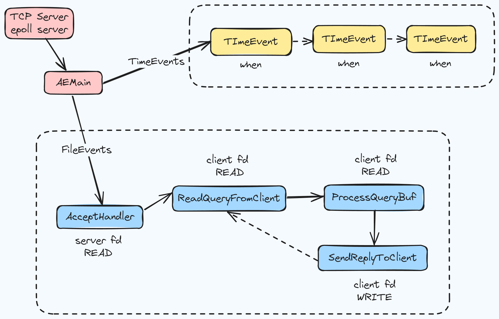
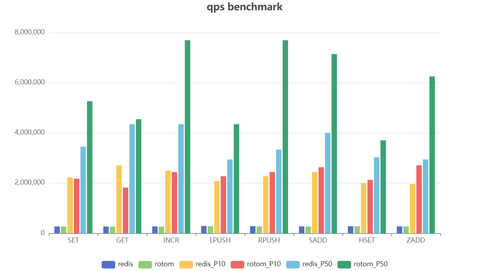

# Rotom

 [](https://codecov.io/gh/xgzlucario/rotom) [](https://github.com/xgzlucario/rotom/actions/workflows/rotom.yml) [](https://github.com/avelino/awesome-go)

English | [中文](README_CN.md)

## Introduction

This is rotom, a high performance, low latency tiny Redis Server written in Go. It replicates the core event loop mechanism AeLoop in Redis based on I/O multiplexing.

## Features

- Implements the AeLoop single-threaded event loop from Redis, on epoll (Linux) or kqueue (macOS/BSD).
- Excellent optimization, achieving native Redis performance.
- Compatible with the Redis RESP protocol, allowing any Redis client to connected.
- Implements data structures String, Hash, Set, List, ZSet.
- Supports RDB & AOF, with redis 7 style multi-part AOF and background AOF rewrite.
- Supports 20+ commonly used commands.

## AELoop

AeLoop (Async Event Loop) is the core asynchronous event-driven mechanism in Redis, which mainly includes:



1. FileEvent: Uses I/O multiplexing to handle read and write events on network sockets, categorized into `READABLE` and `WRITABLE`.
2. TimeEvent: Handles tasks that need to be executed after a delay or periodically, such as expiring items every `100ms`.
3. When events are ready, they are processed by callback functions bound to those events.

In rotom, the AeLoop event loop mechanism in Redis is replicated, specifically:

1. When a new TCP connection arrives, `acceptHandler` accepts it as a non-blocking socket and registers a read event.
2. When the read event is ready, `readQueryFromClient` reads data into the client's `queryBuf`.
3. `processInputBuffer` parses and executes every complete command in `queryBuf`; replies are appended to the client's reply buffer and write commands to the AOF buffer.
4. Before the loop sleeps again, `beforeSleep` writes the AOF buffer, then writes replies to the sockets directly. Only a reply that does not fit into the socket buffer registers a write event, handled by `sendReplyToClient`.

## Data Structures

Rotom has made several optimizations in data structures:

- dict: a port of the redis dict, with incremental rehashing and a reverse-binary `SCAN` cursor. Entries are the bucket nodes themselves and store their expire time inline.
- hash: `zipmap`, values packed in one byte slice plus a field -> offset index.
- set: `zipset` (a listpack) while small, a hash set when it grows.
- list: `quicklist`, a doubly linked list of listpacks.
- zset: `zipzset` (a sorted listpack) while small, a map + skiplist with spans (O(log n) rank and range) when it grows.

`listpack` is the compact list redis uses instead of `ziplist`: entry lengths are stored on both sides, so it can be walked in both directions without cascading updates.

## Code Layout

```
main.go                 flags, logging, startup
internal/
  ae/        event loop (epoll on linux, kqueue on darwin/bsd)
  net/       non-blocking socket syscalls
  resp/      RESP request parser and reply writer (zero allocation)
  server/    clients, query processing, AOF/RDB wiring
  command/   command table and handlers
  db/        keyspace: dict, expiration, value types, RDB
  aof/       multi-part append only file and rewrite
  codec/     binary encoding for RDB
  listpack/  hash/  list/  set/  zset/     data structures
  config/    toml config
  fileutil/  durable atomic file writes
```

## Persistence

With `appendonly = true`, the AOF is a directory, like redis 7's multi-part AOF:

```
appendonlydir/
  appendonly.aof.manifest      the files below, in load order
  appendonly.aof.3.base.rdb    snapshot taken by the last rewrite
  appendonly.aof.7.incr.aof    commands written since
```

`BGREWRITEAOF`, or growth past `auto-aof-rewrite-percentage` / `auto-aof-rewrite-min-size`, starts a rewrite without fork: the dataset is encoded synchronously while writes switch to a new incr file, then the snapshot is written in the background and the manifest is switched once it is durable. A crash at any point leaves a manifest that names a complete dataset.

The encoding step blocks the event loop, about 30ms per 100k keys, where redis' fork is nearly free. An incomplete command at the end of the last incr file, left by a crash mid-write, is truncated on load. A single `appendonly.aof` from older versions is moved into the directory automatically.

## Benchmark



The test will run rotom on the same machine with `appendonly` disabled, and use `redis-benchmark` tool to test the latency of different commands.

```
goos: linux
goarch: amd64
pkg: github.com/xgzlucario/rotom
cpu: 13th Gen Intel(R) Core(TM) i5-13600KF
```

## Roadmap

- [ ] Support for LRU cache and memory eviction.
- [x] AOF Rewrite.

## Usage

**Running Locally**

First, clone the project to your local machine:

```bash
git clone https://github.com/xgzlucario/rotom
```

Ensure your local Go environment is >= `1.22`. In the project directory, run `go run .` to start the service, which listens on port `6379` by default:

```
$ go run .
2024-07-18 23:37:13 DBG 
 ________      _____                  
 ___  __ \_______  /_____________ ___   Rotom 64 bit (amd64/linux)
 __  /_/ /  __ \  __/  __ \_  __ '__ \  Port: 6379, Pid: 15817
 _  _, _// /_/ / /_ / /_/ /  / / / / /  Build: 
 /_/ |_| \____/\__/ \____//_/ /_/ /_/

2024-07-18 23:37:13 INF read config file config=config.json
2024-07-18 23:37:13 INF rotom server is ready to accept.
```

**Running in a Container**

Alternatively, you can run it in a container. First, build the Docker image by running `make build-docker`:

```
REPOSITORY       TAG           IMAGE ID       CREATED         SIZE
rotom            latest        0cd91943967a   5 seconds ago   20.9MB
```

Then, start the container:

```bash
docker run --rm -p 6379:6379 --name rotom rotom:latest
```